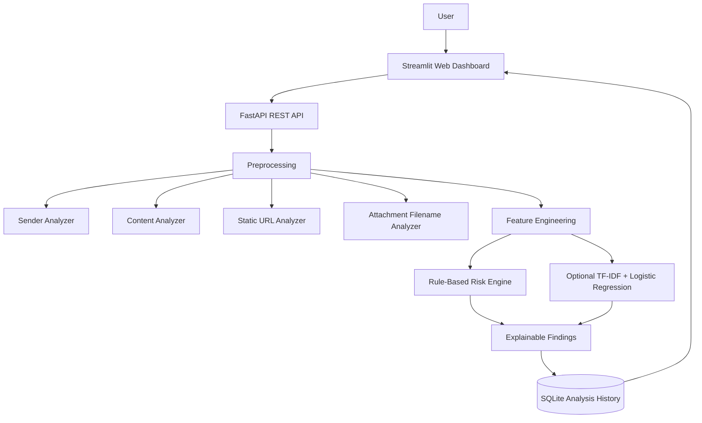

# Architecture

## Data flow

Email input → preprocessing → sender/content/URL/attachment analysis → feature extraction → rule engine and optional ML → risk score/classification → explanation/recommendations → history/dashboard.

Suspicious URLs are parsed as strings only. Attachments are never executed.
